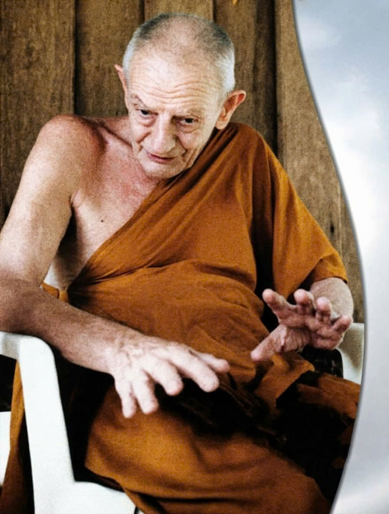

# Ajaan Paññāvaḍḍho Archive

A digital collection of the teachings and life history of Venerable Ajaan Paññāvaḍḍho (1925–2004), a highly revered Western monk of the Thai Forest Tradition.

---

## A Bridge of Dhamma

### The Quiet Depth of Insight

|  | Venerable Ajaan Paññāvaḍḍho (1925–2004) was for over forty years the senior-most Western monk practicing in the Thai Forest lineage of Ajaan Mun Bhūridatta. Intellectual, meticulous, and profoundly humble, his life epitomized absolute dedication to mental development and pure monastic discipline.  Training closely under the renowned master Ajaan Mahā Boowa Ñāṇasampanno at Wat Pa Baan Taad, he became a foundational pillar for generations of international practitioners seeking the core truths of the Dhamma.  [Read his full Biography →](https://meormine.github.io/ajaan-pannavaddho/biography.html) |
| --- | --- |

---

> "Buddhism is not a path of gaining so much as it is a path of relinquishing. The goal is not reached by striving to go higher. The goal is there already. We simply uncover it by getting rid of things."
>
> — **Ajaan Paññāvaḍḍho**

---

## Explore the Archive

- [**Biography**](https://meormine.github.io/ajaan-pannavaddho/biography.html) — Explore the life and journey of Ajaan Paññāvaḍḍho, from his early years to his time as a wandering forest monk.
- [**Dhamma Talks**](https://meormine.github.io/ajaan-pannavaddho/talks.html) — An archive of recorded teachings, transcripts, and practical meditation advice given to his disciples.
- [**Dhamma Books**](https://meormine.github.io/ajaan-pannavaddho/writings.html) — Published writings, essays, and complete books translated into English.
- [**Dhamma Quotes**](https://meormine.github.io/ajaan-pannavaddho/quotes.html) — Brief, impactful reflections and daily inspiration excerpted from his lifelong teachings.
- [**Downloads**](https://meormine.github.io/ajaan-pannavaddho/download.html) — Access the full audio archive and the mobile application for offline listening.

---

*For the complete experience, visit the [Ajaan Paññāvaḍḍho Archive](https://meormine.github.io/ajaan-pannavaddho/).*
